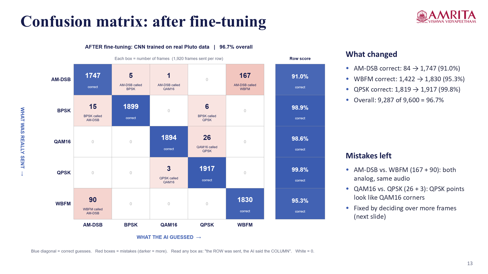

# AI-Powered RF Digital Twin using ADALM-Pluto

Automatic modulation classification on real over-the-air radio signals, using a small 1D CNN in MATLAB and an ADALM-Pluto SDR.

This was our final project for **23AID203 – Software-Defined Communication Systems** at Amrita Vishwa Vidyapeetham (Group A-16).

## What it does

A radio receiver has to know how a signal is modulated before it can decode it. We trained a CNN that looks at the raw I/Q samples of a signal and tells which of five modulations it is:

**AM-DSB · WBFM · BPSK · QPSK · QAM16**

We first trained it on the RadioML 2016.10a dataset, then moved it onto real hardware. One ADALM-Pluto transmits each modulation through one antenna and receives it on another antenna about 2 cm away, at 915 MHz. The received samples go to the same network, and a live MATLAB dashboard shows the prediction in real time.

We call it a *digital twin* because the same network runs in two places: on simulated signals (the dataset) and on real signals (the Pluto). Comparing the two shows how far real signals are from simulated ones.

## Results

| Test | Accuracy |
|---|---|
| CNN trained on RadioML, tested on the RadioML test set | 85.25% |
| Same CNN on real Pluto signals | 74.1% |
| After fine-tuning on real Pluto data (fresh recording, 9,600 frames) | **96.7%** |

- Both training stages use a stratified **70 / 15 / 15** split into training, validation and test sets. Training, validation and test accuracy stay within 1–2 points of each other.
- AM-DSB improved the most (4.4% → 91.0%). Our receiver removes the DC component, which also removes the AM carrier, so real AM-DSB looked quite different from the dataset version.
- Taking a majority vote over 64 consecutive frames (8 ms of signal) gives 100% on the fresh recording. The live dashboard works this way.
- The dataset and hardware numbers come from different conditions (many simulated channels vs one short-range lab link), so they are not a direct comparison.

<p align="center">
  
</p>

More figures are in [`results/`](results), and the full write-up is in [`docs/Project_Report.pdf`](docs/Project_Report.pdf).

## Hardware and software

- ADALM-Pluto SDR (AD9363), two SMA antennas, USB cable in the middle (data) port
- MATLAB R2026b with Communications, DSP System, Signal Processing and Deep Learning toolboxes
- Communications Toolbox Support Package for ADALM-PLUTO Radio

Radio settings: 915 MHz centre frequency, 1 MS/s, 8 samples per symbol, RRC roll-off 0.35, TX gain −30 dB, RX gain 30 dB.

## Repository layout

```
pluto/        MATLAB scripts for the hardware stage (steps 1-7, live dashboard, spectrum scan)
simulation/   mid-review work: dataset conversion, CNN training, dashboard, Simulink model
models/       trained networks (.mat)
data/         recorded Pluto dataset and saved test results
results/      figures and result slides
docs/         final report (PDF) and presentations
```

## How to run it

1. Get the RadioML 2016.10a dataset from DeepSig (it is about 200 MB, so it is not in this repo). Convert it with `simulation/convert_dataset.py` and put `RadioML2016_mid.mat` in `data/`.
2. In MATLAB, add the scripts to the path:
   ```matlab
   addpath('pluto')
   ```
3. Run the steps in order. The details are in [`pluto/README.md`](pluto/README.md).

| Script | What it does |
|---|---|
| `pluto_step1_check` | finds the Pluto and checks the radio link with a 100 kHz tone |
| `pluto_step2_reference` | saves the RadioML reference level used to normalise frames |
| `train_radioml_tvt` | trains the CNN on RadioML (70/15/15) |
| `pluto_step4_collect_dataset` | records 25,000 real frames at 5 power levels |
| `pluto_step6_finetune` | fine-tunes the CNN on the real frames (70/15/15) |
| `pluto_step7_independent_test` | tests on a fresh recording |
| `pluto_step5_evaluate` | accuracy tables, confusion matrices, accuracy vs SNR |
| `pluto_step3_live_digital_twin` | live dashboard, press 1–5 to switch modulation |
| `pluto_spectrum_scan` | scans 325 MHz – 3.8 GHz to see which signals are around (receive only) |

The trained models and our recorded data are already in `models/` and `data/`, so you can run steps 5–7 and the live demo without retraining.

## Things we ran into

- The Pluto only shows up on the laptop when the USB cable is in the middle micro-USB port. The other one is power only.
- With the antennas only 2 cm apart the receiver clipped, so we had to drop the TX gain to −30 dB.
- Starting the transmitter reset the receiver gain, and the receiver kept old buffers from the previous modulation. Restarting the receiver after every transmit start fixed both (`startTransmit.m`).

## Future work

More modulation types (8PSK, GFSK, OFDM, AM variants), a two-Pluto link with frequency-offset correction, classifying real signals in the ISM bands, and running the CNN on the Pluto's FPGA.

## Team

B. Suryacharantej, B. Sai Srikar, P. Sathwik, M. Neeraj. Faculty: Kavitha K.
